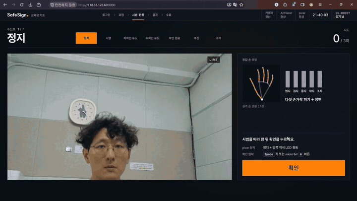

# SafeSign — 산업 안전 수신호 교육 키트

로봇 손이 수신호를 시범하고, 카메라가 학습자의 손 모양을 판정하고, picar와 micro:bit가 결과를 몸으로 보여 주는
피지컬 AI 교육 장비입니다. 크레인 작업 수신호 7종을 강사 없이 반복해서 익힐 수 있습니다.

[](assets/demo.mp4)

▶ **[전체 시연 영상 보기 (1분 20초)](assets/demo.mp4)** — 로그인 → 수신호 시범 → 판정 → picar·LED 반응 → 학습 결과 → 수료증

---

## 1. 무엇을 하나

| 단계 | 장치 | 하는 일 |
| --- | --- | --- |
| ① 시범 | AI Hand(로봇 손) + micro:bit | 이번에 배울 수신호의 손 모양을 보여 준다 |
| ② 따라 하기 | 학습자 | 시범을 보고 같은 손 모양을 만든 뒤 확인 버튼(키보드 Space 또는 micro:bit A)을 누른다 |
| ③ 판정 | 카메라 + RPi5 | 손 관절 21개를 읽어 7종 중 무엇인지, 얼마나 확실한지 판정한다 |
| ④ 피드백 | picar + LED + micro:bit | 정답이면 그 신호대로 picar가 움직이고 LED가 켜진다. 오답이면 micro:bit에 X가 뜨고 시범부터 다시 한다 |

- 수신호마다 **최대 3번** 시도하고, 판정은 한 번에 **최대 10초**를 기다린다.
- 확신이 **75% 미만**이면 정답·오답을 내지 않고 "다시 해 보세요"로 보류한다. 엉뚱한 판정보다 보류가 안전하다고 보았다.
- 7종을 마치면 수신호별 결과와 **수료증**을 보여 준다. 회원 기록은 회원 DB(Supabase)에 남고, 회사 사이트에서 수료증을 다시 받을 수 있다.

### 수신호 7종

| # | 수신호 | 손 모양 | 정답일 때 picar |
| --- | --- | --- | --- |
| 1 | 정지 | 다섯 손가락 모두 펴기 | 정지 · 적색 LED |
| 2 | 서행 | 검지 + 중지 | 감속 주행 |
| 3 | 좌회전 유도 | 엄지 + 검지 | 좌회전 주행 |
| 4 | 우회전 유도 | 엄지 + 소지 | 우회전 주행 |
| 5 | 확인 완료 | 주먹 | LED 전부 점멸 |
| 6 | 후진 | 검지만 | 후진 주행 |
| 7 | 주의 | 소지만 | 정지 · 황색 LED |

크레인 표준신호(팔 동작)를 카메라 한 대로 판정할 수 있게 손 모양으로 바꾼 것입니다. 후진·주의는 자체 지정 신호입니다.

## 2. 성능

학습에 한 번도 쓰지 않은 팀원 3명의 촬영 데이터(3명 × 7종 × 10회 = 210번 시도)로 쟀습니다.

| 항목 | 결과 | 목표 |
| --- | --- | --- |
| 정답률 | **95.2%** (200 / 210) | 92% 이상 |
| 미판정률 (보류) | **4.8%** (10 / 210) | 5% 이하 |
| 다른 신호로 잘못 판정 | **0건** | — |
| 판정 지연 (95% 지점) | **0.046초** | 1.0초 이하 |
| 물리 피드백 시작 (95% 지점) | **0.089초** — picar·micro:bit가 명령을 받기까지 | 2.0초 이하 |

- 정확도는 2026-09-30, 지연은 2026-10-02에 실물(RPi5 + RPi4B)로 측정했습니다.
- 정답률과 미판정률은 95% 신뢰구간이 목표선에 걸쳐 있어 **잠정 달성**으로 기록했습니다.
- 수신호별 정답(30회 중): 정지 30 · 서행 29 · 좌회전 유도 30 · 우회전 유도 30 · 확인 완료 27 · 후진 24 · 주의 30.

## 3. 구성품

| 부품 | 역할 | 연결 |
| --- | --- | --- |
| Raspberry Pi 5 (4GB) | 학습자 앞 고정 스테이션 — 손 인식·판정, 교육 화면, 장치 제어 | 카메라 CSI · micro:bit BLE · picar Wi-Fi · 운영 PC 랜선 직결 |
| Raspberry Pi Camera Module 3 | 학습자 손 촬영 (1280×720) | RPi5에 CSI 케이블(15→22핀) |
| AI Hand (손가락 서보 5개) | 수신호 시범 | micro:bit 확장보드(StartbitV2)가 서보 구동 |
| micro:bit v2 | AI Hand 제어 · O/X 표시 · A 버튼(확인) | RPi5와 BLE(무선) |
| Raspberry Pi 4B (8GB) | picar 제어 | RPi5와 Wi-Fi (RPi5가 AP) |
| picar 차체 (모터 4개) | 정답 신호대로 정지·서행·좌우회전·후진 | RPi4B → 모터 제어 보드(I2C) |
| LED 4개 (적색 2 · 황색 2) | 신호별 점등·점멸 | RPi4B GPIO 4핀 + 저항 220Ω |
| 배터리 3S 11.1V | picar·RPi4B 전원 | 차체 강압 회로로 5V 공급 |

판정 모델 파일(`svm_classifier.joblib`)은 저장소에 포함하지 않고 제품과 함께 따로 제공합니다(§4.1 ④).

## 4. 설치와 실행

### 4.0 구성 한눈에

```
 [운영 PC] ──랜선── [RPi5 (고정 스테이션)] ──Wi-Fi(AP)── [RPi4B (picar 차체)]
  브라우저            vision    :8001                       picar :8000
                      actuation :8002 ──BLE── micro:bit ── AI Hand
                      web       :8000
```

| 보드 | 서비스 | 폴더 | 포트 | 주소 |
| --- | --- | --- | --- | --- |
| RPi4B | picar | [services/picar](services/picar) | 8000 | `192.168.50.10` (AP 고정) |
| RPi5 | actuation | [services/actuation](services/actuation) | 8002 | `localhost` |
| RPi5 | vision | [services/vision](services/vision) | 8001 | `localhost` |
| RPi5 | web | [services/web](services/web) | 8000 | PC에서 `http://<RPi5 eth0 주소>:8000` |

- RPi5 ↔ RPi4B 무선(AP) 구성은 **[docs/network_setup.md](docs/network_setup.md)** 를 먼저 끝냅니다.
- 운영 PC ↔ RPi5 랜선 대역은 현장에 맞게 정합니다. 조건은 하나, picar AP 대역 `192.168.50.x`와 겹치지 않을 것.
  web은 `0.0.0.0`에 뜨므로 코드는 바꿀 필요가 없습니다.

### 4.1 최초 1회 준비

**① 두 보드에 같은 코드 받기**

```bash
# RPi5와 RPi4B 각각에서
git clone -b main https://github.com/Lee35678/SafeSign_PhysicalAI.git ~/git/SafeSign_PhysicalAI
cd ~/git/SafeSign_PhysicalAI
git log --oneline -1          # 두 보드의 커밋이 같아야 한다
```

**② RPi4B — I2C 켜기 + picar 가상환경**

```bash
sudo raspi-config nonint do_i2c 0
i2cdetect -y 1                # 16 이 보여야 한다 (모터 코프로세서 0x16)

cd ~/git/SafeSign_PhysicalAI/services/picar
python3 -m venv --system-site-packages .venv   # OS에 깔린 lgpio·gpiozero를 함께 쓴다
source .venv/bin/activate
pip install -r requirements.txt
```

**③ RPi5 — 서비스마다 가상환경 (3개)**

```bash
# 카메라 라이브러리는 pip가 아니라 apt로 설치한다
sudo apt update && sudo apt install -y python3-picamera2 fonts-nanum tmux
rpicam-hello --list-cameras   # imx708 (Camera Module 3) 이 보여야 한다

cd ~/git/SafeSign_PhysicalAI/services/vision
python3 -m venv --system-site-packages .venv   # ⚠️ 이 옵션이 있어야 venv 안에서 picamera2가 보인다
source .venv/bin/activate && pip install -r requirements.txt && deactivate

cd ~/git/SafeSign_PhysicalAI/services/actuation
python3 -m venv .venv
source .venv/bin/activate && pip install -r requirements.txt && deactivate

cd ~/git/SafeSign_PhysicalAI/services/web
python3 -m venv .venv
source .venv/bin/activate && pip install -r requirements.txt && deactivate
```

> 🔴 `pip install`에서 `error: externally-managed-environment`가 나면 **가상환경이 켜지지 않은 것**입니다.
> `source .venv/bin/activate`부터 하고, **`--break-system-packages`는 쓰지 않습니다**(OS의 Python이 깨질 수 있다).

**④ RPi5 — 판정 모델 파일 넣기**

제품과 함께 받은 `svm_classifier.joblib`을 `services/vision/models/`에 넣습니다.

```bash
# 모델 파일이 있는 PC에서
scp svm_classifier.joblib <계정>@<RPi5 주소>:~/git/SafeSign_PhysicalAI/services/vision/models/
```

손 관절 모델(`hand_landmarker.task`)은 저장소에 들어 있습니다. 자세한 내용은 [services/vision/models/README.md](services/vision/models/README.md).

**⑤ micro:bit — 펌웨어 플래시**

MakeCode(makecode.microbit.org)에서 **StartbitV2 확장이 들어 있는 프로젝트**를 열고, JavaScript 보기에서
기존 내용을 지운 뒤 [services/actuation/src/firmware/aihand_control.ts](services/actuation/src/firmware/aihand_control.ts)를
**통째로 붙여 넣어** 플래시합니다. 켜면 LED에 ◇가 뜹니다.

> ⚠️ 일부만 고쳐 넣지 않습니다 — 저장소와 micro:bit가 어긋나도 동작만 보고는 알기 어렵습니다.

**⑥ RPi5 — 설정 파일 (`.env`)**

```bash
cd ~/git/SafeSign_PhysicalAI
cp .env.example .env          # 회원 기록을 Supabase에 남기려면 SUPABASE_URL·SUPABASE_SERVICE_ROLE_KEY를 채운다
```

키를 비워 두면 RPi5 안에만 저장하는 로컬 모드로 동작합니다(§4.4). `.env`는 git에 올리지 않습니다.

### 4.2 실행

**스크립트로 한 번에 (권장)** — RPi5에서 실행합니다. 서비스가 tmux 안에서 돌기 때문에 SSH가 끊겨도 꺼지지 않습니다.
RPi4B에도 `sudo apt install -y tmux`가 필요합니다.

```bash
cd ~/git/SafeSign_PhysicalAI
bash scripts/rpi/start_all.sh      # 사전 점검 → picar(RPi4B, SSH) → actuation → vision → web, 각각 /health 확인
bash scripts/rpi/status.sh         # 상태 확인 (§4.3) + 온도·스로틀링 + 세션
bash scripts/rpi/stop_all.sh       # picar 정지 명령 → 역순 Ctrl+C → 세션 정리
tmux attach -t safesign            # 로그 보기 (창 0 actuation · 1 vision · 2 web, 빠져나오기 Ctrl+b d)
```

- RPi4B 계정이 RPi5와 다르면 `PICAR_SSH=<계정>@192.168.50.10 bash scripts/rpi/start_all.sh`.
- 사전 점검(남은 uvicorn, BLE 스캔 상태, 모델 파일, 두 보드 커밋, 전원·온도 상태, picar 안전 확인)을 통과하지 못하면 아무것도 띄우지 않습니다.
- 창별 로그와 실행 환경 기록(`env.txt`)은 `~/safesign_logs/<시각>/`에 쌓입니다.
- 부팅할 때 자동으로 켜려면 `sudo bash scripts/rpi/systemd/install.sh rpi5 --enable`(RPi4B는 `rpi4b`). 아직 실물 장기 운전으로 검증하지 않은 선택 기능이며, tmux 스크립트와 동시에 쓰지 않습니다.

> 🔴 **전원·안전** — RPi4B는 차체 배터리에서 전원을 받습니다. **USB-C 어댑터를 동시에 꽂지 않습니다**(헤더 5V에 역류 방지가 없다).
> 배터리 스위치를 손 닿는 곳에 둡니다. 처음 켤 때는 바퀴를 띄우거나 주행 공간을 비워 둡니다.

**수동 실행 (터미널 4개, 이 순서대로)** — 스크립트에서 문제가 날 때 어느 서비스인지 가르는 용도입니다.

```bash
# 터미널 1 — RPi4B: picar
cd ~/git/SafeSign_PhysicalAI/services/picar && source .venv/bin/activate
MOCK_HARDWARE=false uvicorn app:app --app-dir src --host 0.0.0.0 --port 8000

# 터미널 2 — RPi5: actuation (AI Hand + micro:bit)
bluetoothctl show | grep Discovering   # → no 여야 한다
cd ~/git/SafeSign_PhysicalAI/services/actuation && source .venv/bin/activate
MOCK_HARDWARE=false uvicorn app:app --app-dir src --host 0.0.0.0 --port 8002

# 터미널 3 — RPi5: vision (카메라 + 판정)
cd ~/git/SafeSign_PhysicalAI/services/vision
bash scripts/run_rpi5.sh

# 터미널 4 — RPi5: web (⚠️ services/web 폴더에서 실행해야 화면 파일을 찾는다)
cd ~/git/SafeSign_PhysicalAI/services/web && source .venv/bin/activate
VISION_URL=http://localhost:8001 ACTUATION_URL=http://localhost:8002 PICAR_URL=http://192.168.50.10:8000 \
  uvicorn backend.app:app --host 0.0.0.0 --port 8000
```

actuation 콘솔에 `micro:bit BLE 연결됨`이 뜨고 micro:bit LED가 ✓로 바뀌면 연결된 것입니다.
운영 PC 브라우저에서 `http://<RPi5 eth0 주소>:8000`(RPi5에서 `ip -4 addr show eth0`)을 열면 시작 화면이 나옵니다.
화면 상단 장치 상태(카메라 · AI Hand · picar)가 모두 정상이어야 합니다.

### 4.3 상태 확인

```bash
curl -s localhost:8001/health | python3 -m json.tool           # model.loaded: true, camera.state: running
curl -s localhost:8002/health                                  # microbit_connected: true
curl -s 192.168.50.10:8000/health | python3 -m json.tool       # status: ok, hardware.i2c.reachable: true
curl -s localhost:8000/api/state | python3 -m json.tool        # devices 3개 모두 ok
```

진행 중 이상하면 `/api/state`의 `last_dispatch`(어느 장치로 보낸 명령이 실패했는지)와 `live_judgment`를 봅니다.
`ok: true`여도 `body.status`가 `timeout`·`partial`이면 실패입니다.

### 4.4 회원 DB · 회사 사이트

- **회원 DB** — Supabase 프로젝트에 [services/web/supabase/schema.sql](services/web/supabase/schema.sql)을 한 번 실행하고,
  `.env`에 `SUPABASE_URL`·`SUPABASE_SERVICE_ROLE_KEY`를 넣습니다. 절차는 [services/web/supabase/README.md](services/web/supabase/README.md).
  서비스 키는 서버 전용이라 브라우저·git·메신저에 노출하지 않습니다.
- **회사 사이트** — 같은 회원 DB로 회원가입·로그인·학습 기록·수료증 재발급을 제공합니다. 교육장 장비가 없어도 됩니다.
  [render.yaml](render.yaml)로 Render에 올립니다. 절차는 [services/portal/README.md](services/portal/README.md).

### 4.5 모니터링 · 종료

```bash
watch -n2 'vcgencmd measure_temp; vcgencmd get_throttled'   # RPi5 — get_throttled=0x0 이어야 정상 (액티브 쿨러 필요)
python3 scripts/rpi/monitor.py                              # 메모리·CPU·온도·판정 fps를 CSV로 기록, Ctrl+C로 끝내면 요약
```

**종료는 `bash scripts/rpi/stop_all.sh`** 를 씁니다. 수동으로 끌 때는 역순(web → vision → actuation → picar)으로, **반드시 `Ctrl+C`** 로 끕니다.
actuation을 `kill -9`로 끄거나 SSH가 끊기면 **BLE 연결이 남아** 다음 실행 때 micro:bit가 스캔에 안 보입니다(micro:bit에 ✓가 그대로).
그때는 micro:bit를 리셋하거나 `bluetoothctl disconnect <MAC>`.
picar는 `ssh <RPi4B> 'sudo shutdown -h now'`로 끈 뒤, LED가 꺼지면 배터리 스위치를 내립니다.

### 4.6 자주 겪는 문제

| 증상 | 원인 | 조치 |
| --- | --- | --- |
| `uvicorn: command not found` | 가상환경이 안 켜짐 | `source .venv/bin/activate` |
| `externally-managed-environment` | 가상환경 밖에서 pip | 위와 같음. `--break-system-packages` 금지 |
| `micro:bit BLE 연결 실패: TimeoutError` | 다른 BLE 스캔이 켜져 있음 | `bluetoothctl show \| grep Discovering` → `no`로 (모르면 `pkill bluetoothctl`) |
| micro:bit가 스캔에 안 보임 | 이전 서버·bluetoothctl이 연결을 잡고 있음(✓ 표시) | `pgrep -af uvicorn` 확인, micro:bit 리셋 또는 `bluetoothctl disconnect <MAC>` |
| 화면이 계속 대기, vision `model_not_loaded` | 모델 파일 없음 | §4.1 ④ |
| vision `camera.error: picamera2…` | apt 미설치, 또는 venv를 `--system-site-packages` 없이 만듦 | §4.1 ③ 다시 |
| picar가 안 움직임 | web의 `PICAR_URL` 누락, AP 끊김, I2C 꺼짐 | §4.2 터미널 4 · `ping 192.168.50.10` · `i2cdetect -y 1` |
| `get_throttled`가 `0x0`이 아님 | RPi5 과열·전원 부족 | 쿨러·통풍·전원 어댑터 확인 후 재부팅 |

장치별 자세한 내용: [actuation](services/actuation/README.md)(BLE) · [vision](services/vision/README.md)(카메라) ·
[picar](services/picar/README.md)(모터·LED·속도) · [web](services/web/README.md)(교육 화면) · [네트워크](docs/network_setup.md)(AP·SSH).

## 5. 폴더 구조

```
SafeSign_PhysicalAI/
├── services/
│   ├── vision/      # RPi5 — 카메라, 손 관절 인식(MediaPipe), 수신호 판정(SVM)
│   ├── actuation/   # RPi5 — AI Hand · micro:bit BLE 제어 (+ micro:bit 펌웨어 src/firmware/)
│   ├── web/         # RPi5 — 교육 화면, 교육 진행 상태머신, 회원 기록
│   ├── picar/       # RPi4B — picar 주행 · LED
│   └── portal/      # 클라우드 — 회사 사이트 (같은 회원 DB)
├── scripts/rpi/     # 실물 기동 · 상태 · 종료 · 모니터 스크립트, systemd 유닛
├── docs/            # 네트워크(AP) 설정
├── assets/          # 시연 영상
├── .env.example     # 설정 예시 (복사해서 .env)
└── render.yaml      # 회사 사이트 호스팅 설정
```

## 6. 개발 자료

이 브랜치(main)에는 장비에 설치하는 파일만 있습니다. 설계·시험 문서, 자동 테스트, 학습 파이프라인, 데이터 수집 도구,
KPI 측정 자료는 개발 브랜치 **[dev](https://github.com/Lee35678/SafeSign_PhysicalAI/tree/dev)** 에 있습니다.
코드 주석의 `document/…`, `05_모델카드 §…` 같은 표기는 dev 브랜치의 문서를 가리킵니다.

## 7. 만든 사람 — 팀 심기일전

| 이름 | 맡은 일 |
| --- | --- |
| 송승호 (팀장) | AI Hand · micro:bit · picar 하드웨어와 제어, 실물 통합 시험 · 자동 테스트, KPI 측정 |
| 이동혁 | 손 인식 · 판정(MediaPipe + SVM), 판정 타이밍, 회원 DB · 회사 사이트, 화면 디자인 |
| 조은수 | 교육 화면 첫 구현, 판정 타이밍 화면, KPI 집계 |
| 김지훈 | 학습 데이터 확보(공개 데이터셋 27,735건), 사용자 시나리오, 결과 저장 DB 연동 |

2026 Physical AI 프로젝트 (2026-09-04 ~ 10-12)
